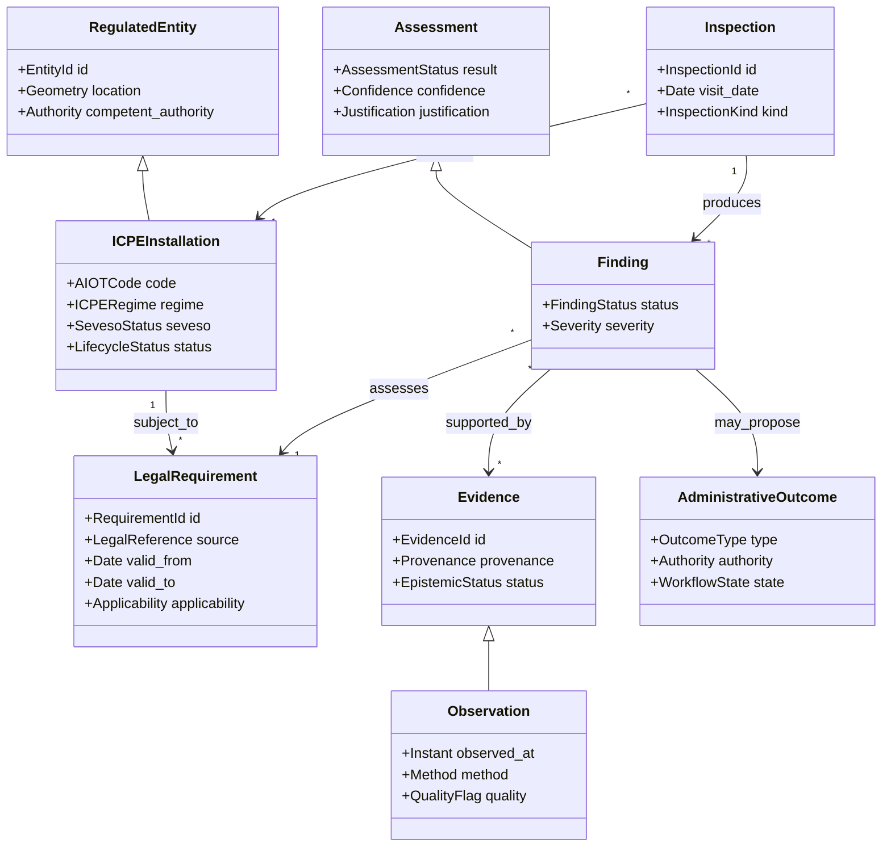
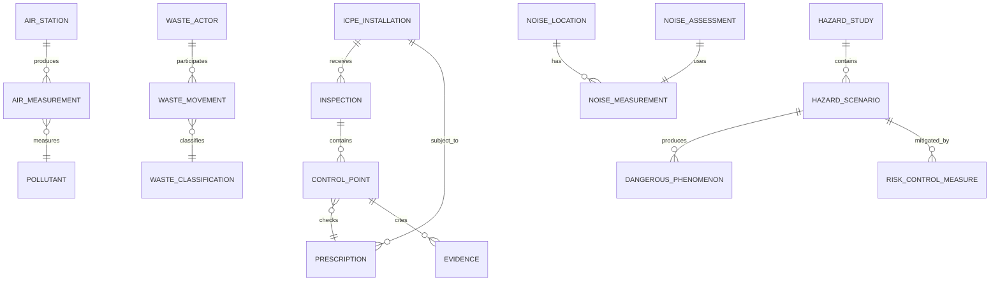
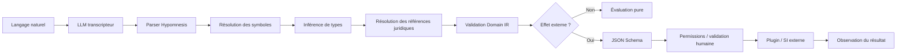
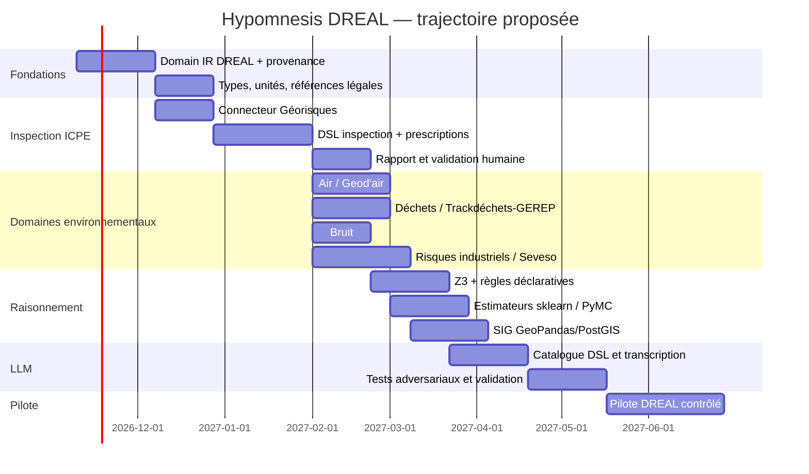

# Construire une représentation métier et un premier jet d’instances de langage pour la DREAL avec Hypomnesis

## Résumé exécutif

L’analyse des missions publiques des DREAL conduit à une conclusion structurante : **la DREAL constitue un excellent domaine pilote pour Hypomnesis parce que son activité combine précisément les différentes formes de raisonnement que le métalangage cherche à unifier** : prescriptions réglementaires, observations de terrain, mesures instrumentales, documents administratifs, calculs, modèles de risque, contraintes spatiales, données incertaines, contrôles de conformité, décisions humaines et interactions avec des systèmes d’information externes. Les DREAL mettent en œuvre les politiques de l’État en matière d’environnement et de risques, instruisent et contrôlent notamment les installations classées, produisent et exploitent de la connaissance géographique et environnementale, et interviennent avec d’autres acteurs comme les préfectures, AASQA, DD(ETS)PP, agences de l’eau et exploitants. citeturn152504search1turn882817search3turn420451search23

Le cas DREAL montre également pourquoi Hypomnesis ne doit **pas** être conçu comme une base de règles monolithique. Le cadre applicable à une installation dépend de sa nomenclature ICPE, de son régime — déclaration, enregistrement ou autorisation —, d’arrêtés ministériels, d’arrêtés préfectoraux spécifiques, de son éventuel statut IED ou Seveso, ainsi que de son historique. L’inspection procède par sondage, confronte observations et documents aux prescriptions applicables, rédige un rapport et propose le cas échéant des suites à l’autorité préfectorale. citeturn831956search2turn420451search0turn420451search6

Le **Domain IR DREAL** devrait donc être centré non sur des objets génériques comme `Sensor` ou `Rule`, mais sur six catégories métier stables : `RegulatedEntity`, `LegalRequirement`, `Evidence`, `Observation`, `Assessment` et `AdministrativeOutcome`. Autour de ce noyau viennent des spécialisations : `ICPEInstallation`, `Inspection`, `AirMeasurement`, `WasteMovement`, `NoiseMeasurement`, `HazardScenario`, `Permit`, `PrefecturalOrder`, `NonConformity`, `Estimate`, `SpatialFeature`, etc. Cette structure reflète notamment la réalité de l’inspection ICPE, où chaque constat doit être rapporté à une prescription identifiable et où les résultats de l’autosurveillance, études et contrôles externes font partie des éléments examinés. citeturn420451search1turn420451search2

Le DSL Hypomnesis doit rester **OCaml-like et fonctionnel**, conformément à la philosophie du projet. Les notions DREAL — inspecteur, installation, polluant, déchet, émergence acoustique, scénario dangereux — doivent être définies dans des modules métier, pas ajoutées comme mots-clés au langage. De même, `Estimator`, `Solver`, `Validator`, `Observer` ou `Transpiler` doivent être des abstractions de bibliothèque. Cette séparation est cruciale pour que le même noyau puisse ensuite servir à d’autres administrations ou industries.

La qualité de l’air offre un premier cas exemplaire. Les mesures réglementaires sont produites régionalement par les AASQA et centralisées dans Geod’air par le LCSQA ; les DREAL s’appuient sur ces données, contrôlent les missions réglementaires des AASQA, pilotent ou suivent les plans de protection de l’atmosphère et participent à la gestion préfectorale des épisodes de pollution. Les données automatiques peuvent être quart-horaires, tandis que Geod’air propose également une API. citeturn462749search2turn462749search5turn152504search0turn152504search3

Il est important de **ne pas figer les seuils réglementaires dans le code métier**. Au 3 novembre 2026, l’article R.221-1 comporte encore notamment 40 µg/m³ comme valeur limite annuelle pour le NO₂, 40 µg/m³ pour les PM10 et 25 µg/m³ pour les PM2,5 ; parallèlement, la directive européenne 2024/2881 doit être transposée au plus tard le 11 décembre 2026 et prévoit pour 2030 des valeurs annuelles respectives de 20, 20 et 10 µg/m³. Les règles Hypomnesis doivent donc être des objets versionnés avec période de validité et source juridique, pas des constantes dispersées. citeturn973328search0turn973328search2turn973328search5

Pour les échanges externes, la recommandation est de retenir **JSON + JSON Schema Draft 2020-12 comme frontière d’effets**, tout en distinguant le schéma métier du transport. Géorisques expose des API et des services WMS/WFS ; Geod’air propose une API ; MonAIOT fédère plusieurs applications administratives comme GIDAF, GEREP, GUNenv, InfoSols, Envinorma ou Vigiedéchets. Hypomnesis doit donc pouvoir adapter JSON, CSV/XML existants, services cartographiques et interfaces applicatives sans imposer son propre format à l’écosystème. citeturn462749search0turn462749search26turn420451search23turn462749search25

Le rôle du LLM doit rester limité à la **transcription et à la proposition**. Il peut identifier qu’un texte parle d’une inspection, d’une prescription ou d’une mesure de PM10 et construire une expression Hypomnesis candidate ; il ne doit jamais inventer une valeur réglementaire, qualifier seul une non-conformité juridiquement significative ou déclencher directement une suite administrative. Cette prudence est cohérente avec le caractère contradictoire de l’inspection et avec les recommandations de la CNIL : lorsqu’une IA générative traite des données personnelles ou des documents sensibles, il faut maîtriser leur réutilisation et envisager des solutions offrant des garanties adaptées, notamment des déploiements maîtrisés lorsque nécessaire. citeturn882817search1turn420451search0turn898740search4

La première version devrait donc réaliser un **vertical slice “inspection ICPE”**, puis étendre le modèle à la qualité de l’air, aux déchets, au bruit et aux risques industriels. Le critère de réussite n’est pas qu’Hypomnesis remplace GIDAF, GEREP, Géorisques ou les outils des AASQA ; c’est qu’il puisse **les décrire et les orchestrer à travers une représentation métier commune, typée, explicable et vérifiable**.

## Cadre métier DREAL et corpus de référence

### Périmètre fonctionnel

Pour un premier métamodèle, il est pertinent de concentrer Hypomnesis sur les activités où la DREAL joue un rôle direct ou d’appui fort : inspection et instruction ICPE, prévention des risques industriels, émissions et nuisances, qualité de l’air, déchets et information géographique. Les DREAL n’exercent cependant pas seules toutes les fonctions : les DD(ETS)PP assurent notamment l’inspection de certaines activités agricoles et agroalimentaires, les AASQA réalisent la surveillance réglementaire régionale de l’air, et le préfet demeure l’autorité décisionnaire de nombreuses procédures administratives. citeturn882817search3turn152504search0turn420451search2

Cette distinction doit être matérialisée dans le DSL par des rôles explicites :

```ocaml
type authority =
  | DREAL
  | Prefect
  | DDETSPP
  | AASQA
  | Operator
  | ApprovedLaboratory
  | ExternalInspector
```

Il ne faudrait notamment pas modéliser une `DREAL` comme l’entité qui « ferme une installation ». L’inspection établit des constats et peut proposer des suites ; le préfet dispose des pouvoirs administratifs correspondants. Le rapport de contrôle est transmis au préfet et à l’exploitant, qui peut présenter ses observations. citeturn882817search1turn420451search0

### Référentiels publics à considérer comme sources de connaissance

| Référentiel | Usage Hypomnesis | Format ou accès public pertinent | Priorité |
|---|---|---|---|
| Code de l’environnement / Légifrance | lois, seuils, obligations, version temporelle | HTML/API à adapter | P0 citeturn831956search5turn973328search0 |
| AIDA / Ineris | nomenclature, prescriptions ICPE, guides d’inspection | pages et documents structurés | P0 citeturn882817search2turn420451search5 |
| Géorisques | ICPE, risques, documents publics, spatialisation | API v1/v2, WMS/WFS, exports | P0 citeturn462749search0turn462749search26 |
| MonAIOT | environnement applicatif ICPE | applications GIDAF, GEREP, GUNenv, Envinorma… | P0/P1 citeturn420451search23 |
| Geod’air / LCSQA | qualité de l’air | API, données automatiques, référentiels | P0 air citeturn462749search2turn462749search5 |
| Trackdéchets / registre national | mouvements de déchets réglementés | plateforme et registres dématérialisés | P0 déchets citeturn928361search13 |
| GEREP | émissions polluantes et déchets | application de déclaration annuelle | P1 citeturn928361search52turn420451search21 |
| GIDAF | autosurveillance fréquente des ICPE | application réglementaire ; paramètres avec codes SANDRE | P1 citeturn928361search29turn420451search31 |

Cette architecture de sources implique que chaque objet métier Hypomnesis dispose de `source_ref`, `retrieved_at`, `valid_from`, `valid_to`, `authority` et, lorsque possible, d’un identifiant canonique. Les évolutions très récentes de la réglementation de l’air montrent que la dimension temporelle est indispensable. citeturn973328search2turn973328search3

### Cinq sous-domaines pilotes

**Inspection d’installation.** Une inspection vérifie par sondage la conformité à des prescriptions applicables, peut comporter examen documentaire, visite des installations et réunion de clôture, puis donne lieu à un rapport et à des suites possibles. citeturn420451search0turn420451search2

**Qualité de l’air.** Le domaine doit représenter les stations, méthodes de mesure, polluants, concentrations, agrégations temporelles, niveaux réglementaires et épisodes. Les polluants réglementés incluent notamment NO₂/NOx, PM10, PM2,5, SO₂, O₃, CO, benzène et plusieurs métaux/HAP. citeturn973328search6turn973328search7

**Déchets.** Le domaine doit couvrir producteur, détenteur, transporteur, destination, code déchet, caractère dangereux, quantité, mouvement, traitement et registres. La réglementation impose des registres chronologiques à de nombreux acteurs et la dématérialisation via Trackdéchets pour plusieurs flux réglementés. citeturn928361search3turn928361search13

**Bruit.** Pour les ICPE concernées par l’arrêté du 23 janvier 1997, l’émergence est la différence entre bruit ambiant avec établissement et bruit résiduel ; l’arrêté fixe également des prescriptions de mesure et encadre les niveaux en limite de propriété. citeturn322187search0turn322187search4

**Risques industriels.** Le domaine doit représenter substances dangereuses, inventaires, seuils Seveso, scénarios accidentels, phénomènes dangereux, effets, mesures de maîtrise des risques et éventuellement PPRT. L’étude de dangers constitue une pièce centrale pour les installations concernées par autorisation. citeturn831956search5turn831956search8turn831956search10

## Métamodèle Hypomnesis DREAL — Domain IR

### Architecture conceptuelle



Cette séparation correspond bien aux pratiques d’inspection : un constat n’a de sens qu’au regard d’une prescription, doit s’appuyer sur des éléments observés ou transmis, et peut conduire à des suites sans confondre constat technique et décision administrative. citeturn420451search0turn420451search50

### Types fondamentaux proposés

```ocaml
type 'a knowledge =
  | Observed  of 'a * provenance
  | Derived   of 'a * derivation
  | Estimated of 'a * estimate_metadata
  | Defaulted of 'a * rule_id
  | Hypothesis of 'a * justification
  | Unknown   of expected_type
  | Conflict  of 'a knowledge list

type legal_reference = {
  jurisdiction : string;
  identifier   : string;
  article      : string option;
  valid_from   : date;
  valid_to     : date option;
  source_uri   : uri;
}

type applicability =
  | Always
  | ICPERegime of icpe_regime
  | Rubric of string
  | Seveso of seveso_status
  | During of date * date option
  | And of applicability list
  | Or of applicability list

type assessment =
  | Conform
  | NonConform of nonconformity
  | NotApplicable
  | NotAssessed
  | Indeterminate of reason
```

La nécessité d’un `NotApplicable` et d’un `NotAssessed` distincts est particulièrement forte dans l’inspection ICPE, car un contrôle est effectué par sondage et ne constitue pas un examen exhaustif de toutes les dispositions applicables. citeturn420451search6

### Sous-modèles métier



Pour les risques industriels, cette structuration suit la logique des études de dangers : description de l’établissement et de son environnement, identification des potentiels et scénarios de danger, analyse des risques et mesures de prévention/maîtrise. citeturn831956search8turn831956search10

### Registre de capacités épistémiques

| Type | Entrée | Sortie | Exemple DREAL |
|---|---|---|---|
| `Observer<I,O>` | requête typée | `Observed<O>` | API Géorisques, Geod’air, lecture GIDAF |
| `Estimator<I,O>` | observations | `Estimated<O>` | interpolation pollution, valeur manquante |
| `Generator<I,O>` | contexte | candidats | points de contrôle d’une inspection |
| `Validator<I>` | objet | verdict + diagnostics | conformité JSON, seuil réglementaire |
| `Solver<P,S>` | problème | solution/statut | contraintes ICPE, spatial, optimisation |
| `Transpiler<A,B>` | représentation A | représentation B | Domain IR → rapport, GeoJSON, requête Z3 |
| `KnowledgeBase<Q,R>` | requête | connaissances sourcées | textes juridiques, AIDA, référentiels |
| `Actuator<I,O>` | commande validée | résultat observé | création d’un brouillon ou export vers SI |

Pour la DREAL, il est recommandé que les actionneurs du MVP restent **administratifs et numériques**. Les textes publics décrivent l’inspection comme une activité de contrôle, de rapport et de proposition de suites à l’autorité compétente, non comme une télécommande des installations inspectées. Un actionneur comme `PrepareFormalNotice` doit donc créer un objet de workflow à faire valider, pas prononcer automatiquement une mise en demeure. citeturn420451search0turn420451search2

## Premier jet du DSL Hypomnesis DREAL

Les fragments suivants sont des **instances de conception Hypomnesis**, pas du code réglementaire exécutable aujourd’hui. Les constantes légales sont toujours référencées par des objets versionnés plutôt qu’encodées directement.

### Inspection d’une installation classée

```ocaml
module Dreal.Inspection = struct

  type finding_status =
    | Conform
    | NonConform
    | NotApplicable
    | NotAssessed
    | Indeterminate

  type finding = {
    installation : ICPE.t;
    requirement  : Regulation.requirement;
    evidence     : Evidence.t list;
    status       : finding_status;
    comment      : string;
  }

  let applicable_requirements installation at_date =
    Knowledge.query
      (Regulation.Requirements {
        subject = installation;
        valid_at = at_date;
      })

  let assess requirement evidence =
    Validator.run
      ~validator:requirement.validator
      ~input:evidence

  let inspect installation scope =
    let requirements =
      applicable_requirements installation scope.date
    in
    requirements
    |> List.filter (Inspection.in_scope scope)
    |> List.map (fun r ->
         let evidence = Observer.collect r.observers in
         assess r evidence)
end
```

Le modèle reflète la logique réelle : vérification de prescriptions générales ou particulières, examen de documents et d’autosurveillance, puis rapport de constats. citeturn420451search1turn420451search6

Un point de contrôle pourrait ensuite être exprimé déclarativement :

```ocaml
let storage_retention =
  Requirement.make
    ~id:"site.storage.retention"
    ~source:(Legal.reference
       ~text:"AP-EXAMPLE"
       ~article:"4.2"
       ~valid_from:"2025-01-01")
    ~subject:Installation.StorageArea
    ~check:(fun area ->
       area.retention_capacity >= required_retention area)
```

Ici la prescription est volontairement fictive : **non spécifié** sans arrêté applicable à une installation réelle.

### Suivi de la qualité de l’air

```ocaml
module Dreal.Air = struct

  type pollutant =
    | NO2 | NOx | PM10 | PM25 | SO2 | O3 | CO | Benzene

  type concentration = Quantity.t<Mass / Volume>

  type measurement = {
    station    : Station.id;
    pollutant  : pollutant;
    value      : concentration;
    instant    : instant;
    method_    : MeasurementMethod.t;
    quality    : QualityFlag.t;
  }

  let observe_geodair =
    Observer.http
      ~capability:"geodair.measurements"

  let annual_mean pollutant values =
    Statistics.mean
      (List.filter_valid values)

  let regulatory_assessment ~at_date pollutant statistic =
    let limit =
      Regulation.lookup
        ~domain:"air"
        ~pollutant
        ~statistic
        ~valid_at:at_date
    in
    Validator.compare_to_limit limit
end
```

Les données automatiques des AASQA sont transmises à Geod’air au fil de l’eau, notamment sous forme quart-horaire, et le LCSQA applique un référentiel technique national de surveillance et de qualité métrologique. citeturn462749search2turn973328search4

Exemple d’utilisation :

```ocaml
let assessment_2026 =
  Dreal.Air.regulatory_assessment
    ~at_date:(Date "2026-11-03")
    Dreal.Air.NO2
    AnnualMean
```

Le fait de passer explicitement `at_date` évite de confondre les seuils français actuels avec les valeurs européennes prévues pour 2030. citeturn973328search0turn973328search2

### Gestion des déchets

```ocaml
module Dreal.Waste = struct

  type movement = {
    waste_code  : WasteCode.t;
    dangerous   : bool;
    quantity    : Quantity.t<Mass>;
    producer    : Actor.t;
    carrier     : Actor.t option;
    destination : Actor.t;
    treatment   : TreatmentCode.t option;
    date        : date;
    tracking_id : string option;
  }

  let validate_traceability movement =
    let requirements =
      Regulation.applicable
        ~domain:"waste_traceability"
        ~context:movement
    in
    Validator.all requirements movement

  let observe_trackdechets =
    Observer.external
      ~capability:"trackdechets.movements"
end
```

La réglementation impose des registres chronologiques à plusieurs catégories d’acteurs et, pour plusieurs déchets réglementés, la dématérialisation des bordereaux via Trackdéchets alimente le registre national. citeturn928361search3turn928361search13

Une règle de cohérence pourrait être :

```ocaml
let movement_mass_balance incoming outgoing =
  Constraint.make
    ~id:"waste.mass_balance"
    (sum_mass outgoing <=
       sum_mass incoming + authorized_generated_mass)
```

La formule précise à employer dépendrait du procédé et de ses prescriptions : **non spécifié** au niveau générique.

### Contrôle du bruit

```ocaml
module Dreal.Noise = struct

  type sound_level = Quantity.t<DecibelA>

  type measurement_pair = {
    ambient  : sound_level;
    residual : sound_level;
    duration : Duration.t;
    location : Geo.point;
    period   : [ `Day | `Night ];
  }

  let emergence m =
    Acoustic.emergence
      ~ambient:m.ambient
      ~residual:m.residual

  let assess installation m =
    let legal_limit =
      Regulation.lookup
        ~domain:"icpe_noise"
        ~installation
        ~period:m.period
        ~location:m.location
    in
    Validator.check legal_limit (emergence m)
end
```

L’arrêté du 23 janvier 1997 définit l’émergence comme la différence entre niveau ambiant et niveau résiduel et prévoit une durée cumulée de mesurage d’au moins une demi-heure à chaque emplacement sauf cas particuliers ; il indique aussi qu’une méthode de contrôle peut utiliser un sonomètre de classe 2 au moins. citeturn322187search1turn322187search4

### Risques industriels

```ocaml
module Dreal.IndustrialRisk = struct

  type dangerous_phenomenon =
    | Fire
    | Explosion
    | ToxicRelease
    | PollutingRelease

  type scenario = {
    initiating_event : Event.t;
    phenomenon       : dangerous_phenomenon;
    probability      : Probability.t knowledge;
    intensity        : Field.t knowledge;
    exposed_targets  : Target.t list;
    safeguards       : SafetyMeasure.t list;
  }

  let seveso_status inventory =
    Solver.solve
      ~solver:"seveso.classification"
      (Seveso.problem inventory)

  let validate_hazard_study study =
    Validator.run
      ~validator:"hazard_study.completeness"
      ~input:study
end
```

Le classement Seveso repose notamment sur des dépassements directs ou des règles de cumul de quantités de substances dangereuses ; la modélisation doit donc conserver inventaires, rubriques et quantités sous une forme vérifiable par solveur, plutôt que demander au LLM d’en déduire lui-même le classement. citeturn831956search5turn831956search6

## Capteurs, contrats JSON et formats de données

### Capteurs et observateurs utiles

Le terme `Sensor` doit être pris au sens large : dans Hypomnesis, une API nationale ou une déclaration GIDAF est aussi un observateur. Les dispositifs de mesure réglementaire doivent conserver leur méthode, leur statut de validation et leur qualité métrologique. Le LCSQA souligne notamment que les micro-capteurs sont des outils complémentaires qui nécessitent une caractérisation de leurs performances, et non des substituts automatiques aux méthodes réglementaires. citeturn462749search7turn462749search17

| Observation | Technologie ou source plausible | Grandeur | Statut recommandé dans Domain IR | Référence |
|---|---|---|---|---|
| NO/NO₂ | analyseur par chimiluminescence | µg/m³ | mesure réglementaire si dispositif conforme | NF EN 14211 citée par LCSQA citeturn992729search8 |
| O₃ | photométrie UV | µg/m³ | mesure réglementaire si dispositif conforme | LCSQA citeturn992729search4turn992729search21 |
| PM10/PM2,5 | gravimétrie ou analyseur équivalent, FIDAS/TEOM selon conditions | µg/m³ | mesure réglementaire/équivalente selon configuration | LCSQA citeturn992729search0turn992729search7 |
| bruit | sonomètre | dB(A), Leq | contrôle/expertise selon méthode | arrêté ICPE bruit citeturn322187search1 |
| substances/émissions ICPE | autosurveillance ou laboratoire | dépend du paramètre | observation externe qualifiée | AIDA/GIDAF citeturn882817search2turn420451search31 |
| ICPE / localisation | Géorisques API/WFS | géométrie + attributs | donnée administrative externe | Géorisques citeturn462749search0turn462749search26 |
| déchets | Trackdéchets / registre | mouvement, masse, acteurs | donnée déclarative | ministère citeturn928361search13 |

### JSON Schema d’une mesure environnementale

JSON Schema Draft 2020-12 est la version publiée actuelle de la spécification et fournit les primitives nécessaires à la validation structurelle proposée pour Hypomnesis. citeturn599293search0turn599293search2

```json
{
  "$schema": "https://json-schema.org/draft/2020-12/schema",
  "$id": "urn:hypomnesis:dreal:air-observation:1.0",
  "title": "AirObservation",
  "type": "object",
  "required": [
    "observation_id",
    "station_id",
    "pollutant",
    "value",
    "unit",
    "observed_at",
    "quality_status"
  ],
  "properties": {
    "observation_id": {
      "type": "string",
      "minLength": 1
    },
    "station_id": {
      "type": "string"
    },
    "pollutant": {
      "enum": ["NO2", "NOx", "PM10", "PM2.5", "SO2", "O3", "CO", "C6H6"]
    },
    "value": {
      "type": "number"
    },
    "unit": {
      "enum": ["ug/m3", "mg/m3"]
    },
    "observed_at": {
      "type": "string",
      "format": "date-time"
    },
    "method": {
      "type": ["string", "null"]
    },
    "quality_status": {
      "enum": ["raw", "provisional", "validated", "invalid"]
    },
    "source": {
      "type": ["string", "null"]
    }
  },
  "additionalProperties": false
}
```

Le champ `quality_status` est essentiel : Geod’air reçoit des données automatiques en temps réel, et le dispositif réglementaire comprend des processus de contrôle et de validation de la qualité des mesures. citeturn462749search2turn992729search17

### JSON Schema d’un constat d’inspection proposé

```json
{
  "$schema": "https://json-schema.org/draft/2020-12/schema",
  "$id": "urn:hypomnesis:dreal:inspection-finding-command:1.0",
  "title": "ProposeInspectionFinding",
  "type": "object",
  "required": [
    "inspection_id",
    "requirement_id",
    "assessment",
    "evidence_ids"
  ],
  "properties": {
    "inspection_id": {
      "type": "string"
    },
    "requirement_id": {
      "type": "string"
    },
    "assessment": {
      "enum": [
        "conform",
        "non_conform",
        "not_applicable",
        "not_assessed",
        "indeterminate"
      ]
    },
    "evidence_ids": {
      "type": "array",
      "items": {"type": "string"},
      "minItems": 1
    },
    "comment": {
      "type": "string"
    },
    "generated_by": {
      "enum": ["human", "rule", "solver", "llm_assisted"]
    },
    "requires_human_approval": {
      "const": true
    }
  },
  "additionalProperties": false
}
```

Ce schéma est une proposition Hypomnesis, **pas un format DREAL existant**. L’obligation de validation humaine proposée est cohérente avec la responsabilité de l’inspecteur, le caractère contradictoire du contrôle et le rôle du préfet pour les suites administratives. citeturn882817search1turn420451search0

### Format géographique

Pour la couche spatiale, Hypomnesis devrait accepter au minimum `GeoJSON`, `WKT`, WMS/WFS et les types `geometry/geography` de PostGIS. Géorisques propose des recherches géographiques par latitude/longitude, rayon, parcelle, code INSEE et géométrie WKT dans ses API v2, ainsi que des services WMS/WFS. citeturn462749search0turn462749search26

Un type canonique peut rester simple :

```ocaml
type geometry =
  | Point of crs * float * float
  | LineString of crs * point list
  | Polygon of crs * ring list
  | ExternalGeometry of format * string
```

Il faudra stocker explicitement le CRS/SRID ; PostGIS distingue notamment `geometry` et `geography` et s’appuie sur des identifiants de systèmes de référence spatiale. citeturn599293search26turn599293search37

## Extensions Python, solveurs et intégration LLM

### Registre Python recommandé

| Extension | Rôle Hypomnesis | Premier usage DREAL | Motivation technique |
|---|---|---|---|
| `pint` | unités | concentrations, masses, distances, débits | `Quantity` + conversions d’unités citeturn587689search37turn587689search35 |
| `scikit-learn` | `Estimator` | détection d’anomalies, régression, classification auxiliaire | pipelines et estimateurs composables citeturn587689search28turn587689search36 |
| `PyMC` | `BayesianEstimator` | estimation avec distribution/incertitude | prédiction postérieure et posterior predictive checks citeturn587689search10turn587689search13 |
| `z3-solver` | `Solver` | règles de classement, contraintes symboliques | arithmétique/logique et API Python citeturn587689search0turn587689search8 |
| `RDFLib` | `KnowledgeBase` | ontologies, relations, graphes juridiques | RDF, JSON-LD, Turtle, SPARQL citeturn599293search5turn599293search4 |
| `GeoPandas` | géotraitement | proximité ICPE, PPRT, stations, parcelles | GeoJSON, fichiers SIG, PostGIS et jointures spatiales citeturn599293search35turn599293search36 |
| `PostGIS` | stockage spatial | requêtes territoriales à grande échelle | géométries, géographies, index spatiaux citeturn599293search26turn599293search31 |

Un modèle scikit-learn chargé par un plugin doit être versionné avec son environnement ; la documentation officielle rappelle que les formats basés sur `pickle` peuvent exécuter du code lors du chargement et que la compatibilité inter-versions n’est pas garantie. Pour Hypomnesis, les plugins doivent donc être installés depuis une chaîne de confiance et les artefacts de modèles doivent conserver dépendances, version et empreinte. citeturn587689search1turn587689search29

Exemple de registre :

```ocaml
module Extensions = struct

  let air_interpolator =
    Estimator.python
      ~id:"dreal.air.kriging.v1"
      ~input:Schema.air_samples
      ~output:Schema.air_field
      ~callable:"dreal_models.air:estimate_field"

  let seveso_solver =
    Solver.python
      ~id:"dreal.seveso.z3.v1"
      ~problem:Problem.seveso_classification
      ~callable:"dreal_solvers.seveso:solve"

  let georisques =
    Observer.http
      ~id:"georisques.icpe.v2"
      ~response_schema:Schema.icpe_records

  let inspection_report =
    Transpiler.python
      ~id:"dreal.inspection.report.v1"
      ~input:Domain.Inspection.schema
      ~callable:"dreal_reports.inspection:render"
end
```

### Sélection des solveurs

| Problème | Solveur conseillé | Garantie attendue |
|---|---|---|
| contraintes booléennes/arithmetic simples | Z3 | `sat`, `unsat`, `unknown` |
| classement Seveso / règles de cumul | Z3 | satisfiabilité des contraintes formalisées |
| optimisation d’implantation | optimisation numérique/OR-Tools à ajouter | optimum ou meilleure solution connue selon backend |
| proximité géographique | PostGIS/GeoPandas | résultat géométrique déterministe |
| estimation d’une concentration manquante | scikit-learn/PyMC | estimation, pas preuve |
| interprétation d’un texte de prescription | LLM + parser | candidat à valider, aucune garantie juridique |

Z3 expose explicitement des solveurs de contraintes et de l’optimisation via ses API ; une prédiction PyMC ou scikit-learn est d’une nature épistémique différente et doit rester `Estimated`, jamais être promue automatiquement en `Derived`. citeturn587689search0turn587689search8turn587689search10

### Stratégie LLM

Le LLM doit recevoir **un catalogue de domaine réduit au contexte**, et non tout le corpus réglementaire brut. Le prompt système métier devrait contenir :

```text
ROLE
Tu transcris une demande DREAL vers le DSL Hypomnesis.

REGLES
- N'invente jamais un article, un seuil, une unité ou un identifiant.
- Utilise Unknown(...) lorsqu'une information est absente.
- Une donnée issue d'un document est Observed(...).
- Une valeur produite par un modèle est Estimated(...).
- Ne qualifie pas juridiquement une non-conformité sans exigence résolue.
- N'émets aucune commande d'effet : produis uniquement des expressions DSL.

CONCEPTS DISPONIBLES
<catalogue typé limité au sous-domaine>

CAPACITES DISPONIBLES
<signatures Observer / Validator / Solver / Estimator>

SORTIE
Programme Hypomnesis uniquement.
```

Cette stratégie est recommandée parce que les sources juridiques et techniques évoluent et que la DREAL manipule potentiellement des informations sensibles. La CNIL recommande d’examiner les risques liés aux données personnelles et à leur éventuelle réutilisation par un fournisseur de modèle ; pour des données personnelles ou des documents sensibles, elle considère généralement plus appropriées des solutions offrant des garanties de maîtrise renforcées, notamment sur site dans certains cas. citeturn898740search2turn898740search4

La chaîne de validation proposée est :



Aucun diagnostic du compilateur ne doit être « corrigé » silencieusement par le LLM. Le diagnostic doit être renvoyé comme donnée structurée, puis une nouvelle proposition doit être parsée et revalidée depuis le début.

Pour une administration, il faut en outre évaluer au cas par cas l’applicabilité du règlement européen sur l’IA. Le texte consolidé prévoit notamment des obligations spécifiques pour certains systèmes à haut risque et des exigences supplémentaires pour certains déployeurs publics ; cela ne signifie pas que tout usage d’Hypomnesis par une DREAL serait automatiquement « haut risque ». citeturn898740search0turn898740search6

## Plan d’implémentation et conformité

### Roadmap priorisée



Cette timeline est une **proposition d’ingénierie**, pas un calendrier officiel DREAL.

Le premier incrément devrait uniquement savoir accomplir la chaîne suivante :

```text
AIOT
  → chargement Géorisques
  → résolution des prescriptions applicables
  → constitution d'une fiche d'inspection
  → saisie/import d'observations
  → évaluation assistée
  → brouillon de constats
  → validation humaine
  → export de rapport
```

Cette cible est compatible avec l’existence d’Envinorma, qui sert déjà à préparer des fiches d’inspection à partir notamment du nom, code AIOT ou de la localisation d’une ICPE ; Hypomnesis devrait donc chercher la complémentarité ou l’intégration, pas recréer sans étude l’ensemble de cette fonction. citeturn420451search17

### Checklist de conformité environnementale et administrative

| Contrôle | Exigence Hypomnesis | Statut MVP |
|---|---|---|
| Régime ICPE | identifier déclaration/enregistrement/autorisation et rubriques applicables | obligatoire citeturn831956search2 |
| Prescription | chaque évaluation référence le texte et la version applicables | obligatoire citeturn420451search1 |
| Inspection | distinguer contrôlé, non contrôlé et non applicable | obligatoire citeturn420451search6 |
| Contradictoire | conserver observations exploitant et historique des constats | obligatoire citeturn882817search1 |
| Autosurveillance | importer mesures et commentaires de conformité lorsqu’applicables | obligatoire par domaine citeturn882817search2turn928361search29 |
| Air | versionner seuils et référentiels de mesure ; ne pas confondre 2026/2030 | obligatoire citeturn973328search0turn973328search2 |
| Métrologie air | conserver méthode, validation et qualité de mesure | obligatoire citeturn992729search17turn992729search20 |
| Déchets | représenter acteur, flux, code, quantité, destination et traçabilité | obligatoire citeturn928361search3turn928361search13 |
| Bruit | représenter résiduel, ambiant, émergence, période, localisation et protocole | obligatoire citeturn322187search0turn322187search4 |
| Seveso | inventaire des substances + règles de seuil/cumul versionnées | obligatoire pour module risques citeturn831956search5turn831956search6 |
| Étude de dangers | scénario, causes, phénomènes, conséquences, mesures de maîtrise | P1 citeturn831956search8turn831956search10 |
| Accident/incident | prévoir événement, causes, effets, actions correctives et délais documentaires | P1 citeturn420451search29 |
| JSON externe | validation Draft 2020-12 à chaque frontière | obligatoire citeturn599293search0 |
| SIG | conserver CRS/SRID et provenance des géométries | obligatoire citeturn599293search37 |
| LLM | aucune exécution directe, sorties parsées/typées/validées | obligatoire |
| Données personnelles | analyse RGPD, minimisation et maîtrise des données envoyées au modèle | obligatoire citeturn898740search1turn898740search4 |
| Sécurité SI État | analyse de risques et homologation selon cadre applicable du RGS | obligatoire avant production citeturn898740search14turn898740search30 |
| Décisions administratives | validation humaine et séparation proposition/décision | obligatoire citeturn420451search0turn882817search1 |
| IA Act | qualification juridique du cas d’usage avant déploiement | à instruire citeturn898740search6 |

### Stratégie de validation

La validation doit comporter quatre niveaux indépendants. **Le niveau syntaxique** teste que le programme appartient au DSL. **Le niveau statique** vérifie types, unités et références. **Le niveau métier** compare le résultat aux prescriptions et référentiels applicables. **Le niveau épistémique** contrôle que provenance et statut (`Observed`, `Derived`, `Estimated`, etc.) ne sont jamais confondus.

Le jeu d’essai initial devrait utiliser des rapports d’inspection publiés sur Géorisques, puisqu’on y trouve des rapports associés à des ICPE et des historiques de textes publics, permettant de construire un corpus réel sans partir de données opérationnelles confidentielles. citeturn420451search32turn831956search13

Un benchmark utile contiendrait au moins : prescription satisfaite, prescription violée, prescription non applicable, preuve insuffisante, texte réglementaire modifié dans le temps, contradiction entre deux sources, valeur estimée à distinguer d’une valeur mesurée, unité incorrecte, seuil expiré, et demande LLM tentant d’inventer une référence réglementaire.

La première expérimentation doit mesurer non seulement le taux de bonne réponse, mais surtout les **faux positifs de conformité**. Dans un outil d’aide au contrôle, une erreur correctement signalée comme `Indeterminate` est préférable à une conformité inventée.

### Sources principales

Le socle documentaire recommandé pour le projet est le **Code de l’environnement sur Légifrance**, qui demeure la référence pour les textes en vigueur, notamment pour les ICPE, la qualité de l’air et le régime Seveso. citeturn882817search1turn973328search0turn831956search5

Pour la pratique de l’inspection et la réglementation technique des ICPE, **AIDA/Ineris** fournit une documentation particulièrement proche du besoin de métamodélisation, notamment sur l’organisation, les contrôles, les suites de visite et les régimes ICPE. citeturn882817search2turn420451search0turn420451search5

Pour les données territoriales et industrielles, **Géorisques** doit être considéré comme une source prioritaire : données ICPE, documents publics, API, données ouvertes et services cartographiques. citeturn462749search1turn462749search26

Pour la qualité de l’air, **LCSQA/Geod’air** constitue la référence technique nationale : données de mesure, API, référentiels métrologiques et méthodes de surveillance. citeturn462749search2turn973328search4turn992729search3

Pour les déchets, les pages du **ministère chargé de l’environnement**, l’arrêté du 31 mai 2021 et les services Trackdéchets/registre national forment le socle à intégrer. citeturn928361search3turn928361search13

Pour la sécurité et l’intégration d’IA dans un contexte administratif, les références de base sont la **CNIL**, le **RGS/ANSSI** et, selon la qualification du cas d’usage, le règlement européen sur l’intelligence artificielle. citeturn898740search4turn898740search30turn898740search6

La conclusion architecturale est donc nette : le premier **Hypomnesis-DREAL** ne devrait pas être un « chatbot réglementaire ». Il devrait être un **système de représentation exécutable du raisonnement environnemental** dans lequel chaque constat relie une entité réglementée, une exigence versionnée, des preuves qualifiées, une méthode d’évaluation et une conclusion dont la provenance est conservée. Les LLM interviennent à la périphérie pour traduire et proposer ; les règles, bases de connaissances, validateurs et solveurs portent la sémantique métier ; et toute action vers un système externe traverse un contrat typé et validé.